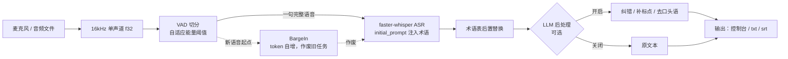

# 架构说明

## 一、数据流

## 二、延迟预算（参考值，small 模型 / CPU int8）

| 阶段 | 单句耗时 | 说明 |
|---|---|---|
| VAD 切分 | ≈ 0 ms | 帧级能量计算，可忽略 |
| 等待句尾 | 600 ms | `VAD_HANGOVER_MS`，越小越快但易截断 |
| ASR 推理 | 0.3–0.8 s | 10 s 音频、small、CPU int8 |
| 术语替换 | ≈ 1 ms | 纯字符串 |
| LLM 后处理 | 0.5–2 s | 可关闭，关闭后整链 < 1 s |

关键结论：**瓶颈在 ASR 与 LLM，不在切分**。因此把 VAD 做在本地、把 LLM 设为可选，是保证"断网也能演示"的核心取舍。

## 三、三个设计取舍

1. **不用 webrtcvad / silero，自己写能量 VAD**
   零额外依赖、易解释。代价是对强噪声环境不鲁棒——这是后续升级点，接口已经隔离在 `src/vad.py`，换成 Silero 只需替换 `EnergyVAD`。

2. **切分在 ASR 之前，而不是让 whisper 自己切**
   whisper 的 `vad_filter=True` 会对长音频二次截断，导致句首丢字。本项目先切分再逐句识别，`vad_filter=False`，并把 `condition_on_previous_text=False` 以避免跨句串话。

3. **LLM 只做后处理，不做理解**
   Agent 介入越深，延迟与不确定性越高。当前只让它纠错与补标点，且失败自动降级为原文，保证主链路可用。

## 四、打断（barge-in）实现

`BargeIn` 维护一个自增 token：

- 每检测到**新语音起点**（`Segmenter.on_speech_start`），token+1；
- 后台识别任务在开始时记录当时的 token；
- 任务结束时比对：token 已变则说明用户已开口，**丢弃该结果、不输出**。

这是"逻辑打断"，不涉及音频播放中断，因此实现成本极低，但已经能演示 FDE / 语音 Agent 面试中最常问的场景。

## 五、可扩展点

| 方向 | 落点 |
|---|---|
| 换更准的 VAD | `src/vad.py` 替换 `EnergyVAD` |
| 接入流式 ASR | `src/asr.py` 改为流式接口，保持 `process()` 签名 |
| 实时语音对话（TTS） | 在此链路后接 TTS + 播放，或迁移到 pipecat |
| 服务化 | `src/pipeline.py` 的 `Transcriber` 已是无状态类，可直接被 FastAPI 包装 |
| 多路并发 | `run_mic` 的 `ThreadPoolExecutor` 换成进程池或任务队列 |
